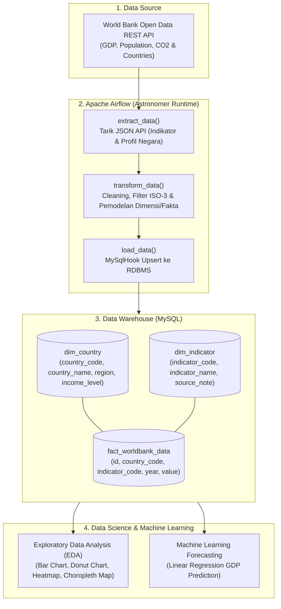
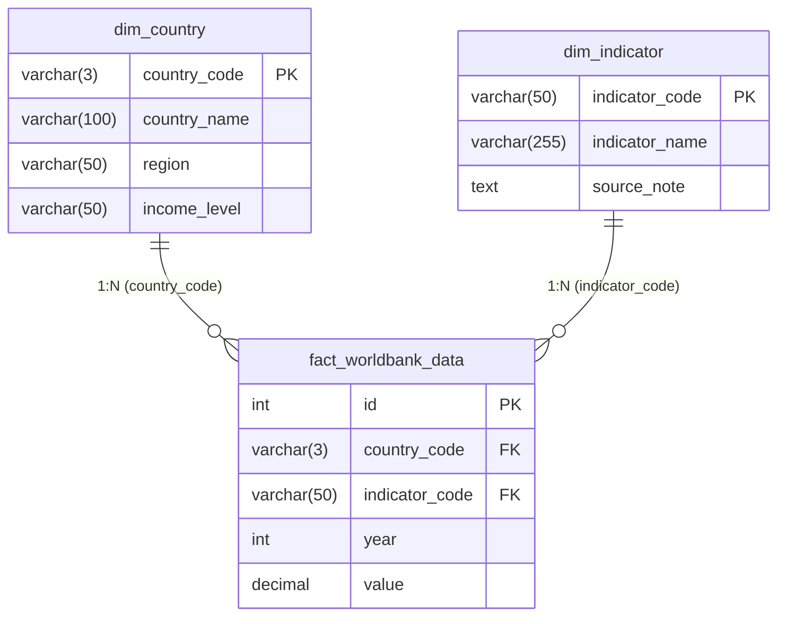

# worldbank-dashboard

# 🌍 Global Economic & Demographic Insights (GEDI)
### Automated World Bank ETL Pipeline, Data Warehouse & Predictive Analytics

[](https://airflow.apache.org/)
[](https://www.astronomer.io/)
[](https://www.python.org/)
[](https://www.mysql.com/)
[](https://pandas.pydata.org/)
[](https://scikit-learn.org/)

---

## 📖 Ringkasan Proyek

Repository ini berisi implementasi **End-to-End Data Engineering & Predictive Analytics Pipeline** berbasis data terbuka dari **World Bank (Bank Dunia)**. 

Proyek ini mengotomatiskan siklus hidup data mulai dari ekstraksi data API secara terjadwal menggunakan **Apache Airflow (Astronomer CLI)**, pembersihan serta transformasi data dengan skema bintang (*Star Schema*), pemuatan ke data warehouse **MySQL**, hingga analisis eksplorasi data (*Exploratory Data Analysis / EDA*) dan peramalan tren ekonomi masa depan (*Predictive Machine Learning*).

---

## 🎯 Tujuan & Fitur Utama

1. **Automated ETL Pipeline (Data Engineering)**:
   - Menarik data indikator pembangunan global (*GDP*, *Total Population*, dan *CO2 Emissions*) serta profil metadata negara dari REST API World Bank (2014–2025).
   - Validasi data ketat: memfilter agregat wilayah regional non-negara, mencocokkan kode negara standar ISO-3, membuang data duplikat dan *missing values*.
   - Menggunakan Airflow TaskFlow API dengan `MySqlHook` untuk operasi *upsert* / *replace*.
2. **Data Warehouse Modeling (Star Schema)**:
   - Memodelkan data ke dalam tabel dimensi (`dim_country`, `dim_indicator`) dan tabel fakta (`fact_worldbank_data`).
3. **Exploratory Data Analysis (Data Analytics)**:
   - Menjawab pertanyaan bisnis mengenai peringkat negara berdasarkan GDP, distribusi tingkat pendapatan (*Income Level*), korelasi populasi vs. ekonomi, serta pemetaan geospasial populasi global.
4. **Predictive Modeling (Machine Learning)**:
   - Proyeksi dan estimasi nilai GDP negara (studi kasus: Indonesia) menggunakan regresi berbasis deret waktu (*Time-Series Linear Regression*).

---

## 🏗️ Arsitektur Sistem & Alur Data



---

## 🗄️ Model Data (Star Schema)

Database `worldbank_db` dirancang dengan arsitektur **Star Schema**:



### Indikator Bank Dunia yang Digunakan
| Kode Indikator | Nama Indikator | Deskripsi Singkat |
|---|---|---|
| `NY.GDP.MKTP.CD` | GDP (Current US$) | Produk Domestik Bruto dalam USD berjalan |
| `SP.POP.TOTL` | Population, total | Jumlah total estimasi penduduk |
| `EN.ATM.CO2E.KT` | CO2 emissions (kt) | Emisi karbon dioksida dalam kiloton |

---

## 📂 Struktur Direktori Proyek

```text
worldbank-etl/
├── .astro/                                       # Konfigurasi internal Astronomer CLI
├── dags/
│   ├── .airflowignore                            # File pengabaian Airflow
│   └── worldbank_etl_dag.py                      # DAG Airflow: Ekstraksi, Transformasi & Load ke MySQL
├── E1E124065_La_Ode_Muhammad_Fauzilazhim.ipynb   # Notebook Analisis: EDA & Linear Regression Model
├── Salinan_dari_data_world_bank_kedua.ipynb      # Notebook Eksperimen Alternatif (XGBoost Regressor)
├── worldbank_db.sql                              # Backup DDL & Dump Data Star Schema MySQL
├── airflow_settings.yaml                         # Konfigurasi lokal koneksi & variabel Airflow
├── requirements.txt                              # Dependensi Python untuk runtime Airflow
├── Dockerfile                                    # Dockerfile Astronomer Runtime
├── packages.txt                                  # Dependensi tingkat OS Linux (opsional)
├── .gitignore                                    # File pengabaian Git
└── README.md                                     # Dokumentasi lengkap proyek
```

---

## 📊 Pertanyaan Bisnis & Analisis Data

Notebook analisis menjawab 5 pertanyaan kunci:

1. **Top 10 Negara dengan Rata-rata GDP Tertinggi**:
   - Membandingkan performa perekonomian negara terbesar di dunia (misal: USA, China, Jepang, Jerman) berdasarkan rata-rata GDP historis.
2. **Distribusi Negara Berdasarkan Tingkat Pendapatan (*Income Level*)**:
   - Menganalisis proporsi persentase pembagian status ekonomi negara (*High income*, *Upper middle income*, *Lower middle income*, *Low income*).
3. **Korelasi Antara Jumlah Populasi dan GDP Global**:
   - Uji korelasi numerik untuk melihat apakah negara berpopulasi tinggi selalu memiliki ekonomi yang lebih besar.
4. **Analisis Spasial / Geospasial Populasi Global**:
   - Visualisasi peta tematik (*Choropleth Map*) untuk memetakan konsentrasi kepadatan demografi di berbagai benua.
5. **Prediksi Tren GDP Masa Depan (Studi Kasus: Indonesia)**:
   - Pelatihan model **Linear Regression** pada deret waktu historis untuk memproyeksikan GDP Indonesia pada tahun 2026–2027.
   - Evaluasi performa model menggunakan metrik $R^2$ (*Coefficient of Determination*) dan MAE (*Mean Absolute Error*).

---

## 🚀 Panduan Instalasi & Menjalankan Proyek

### 1. Prasyarat Sistem
Pastikan perangkat Anda telah terpasang:
- [Docker Desktop](https://www.docker.com/products/docker-desktop/) (Harus dalam keadaan *running*)
- [Astro CLI (Astronomer)](https://www.astronomer.io/docs/astro/cli/install-cli)
- [Python 3.10+](https://www.python.org/)
- [MySQL Server](https://dev.mysql.com/downloads/mysql/) atau [XAMPP / phpMyAdmin](https://www.apachefriends.org/)

---

### 2. Konfigurasi Database MySQL
1. Buat database baru bernama `worldbank_db` di server MySQL Anda:
   ```sql
   CREATE DATABASE worldbank_db;
   ```
2. Import skema dan data awal menggunakan file [worldbank_db.sql](worldbank_db.sql):
   ```bash
   mysql -u root -p worldbank_db < worldbank_db.sql
   ```
   *(Atau import melalui antarmuka phpMyAdmin)*.

---

### 3. Konfigurasi Koneksi Airflow ke MySQL
Karena Airflow berjalan di dalam container Docker, host database lokal harus diarahkan ke `host.docker.internal`:

Anda dapat mengaturnya melalui file `airflow_settings.yaml` atau langsung di **Airflow UI** (`Admin` -> `Connections`):

- **Connection Id**: `mysql_default`
- **Connection Type**: `MySQL`
- **Host**: `host.docker.internal` (atau IP lokal host)
- **Database/Schema**: `worldbank_db`
- **Login / Username**: `root` (sesuaikan dengan kredensial Anda)
- **Password**: *(password MySQL Anda)*
- **Port**: `3306`

---

### 4. Menjalankan Apache Airflow
Buka terminal pada direktori proyek, lalu jalankan:

```bash
# Inisialisasi dan jalankan container Airflow
astro dev start
```

Perintah di atas akan mengunduh image dan menyalakan 5 container utama:
- `Postgres` (Metadata Database Airflow)
- `Scheduler`
- `DAG Processor`
- `Triggerer`
- `Webserver / API Server`

Setelah selesai, buka antarmuka Airflow di browser:
- **URL**: [http://localhost:8080](http://localhost:8080)
- **Username Default**: `admin`
- **Password Default**: `admin`

Cari DAG bernama `worldbank_api_to_mysql`, aktifkan tombol **Toggle**, lalu klik tombol **Trigger DAG** untuk menjalankan pipeline ETL.

Untuk menghentikan Airflow jika selesai digunakan:
```bash
astro dev stop
```

---

### 5. Menjalankan Notebook Analisis & Machine Learning
Jalankan Jupyter Notebook atau VS Code:

```bash
# Install paket analisis data yang dibutuhkan
pip install pandas numpy matplotlib seaborn plotly scikit-learn jupyter

# Jalankan Jupyter Notebook
jupyter notebook
```

Buka file [E1E124065_La_Ode_Muhammad_Fauzilazhim.ipynb](E1E124065_La_Ode_Muhammad_Fauzilazhim.ipynb) dan jalankan seluruh cell (*Run All*) untuk melihat visualisasi dan hasil peramalan Machine Learning.

---

## 🛠️ Teknologi & Pustaka

| Kategori | Teknologi / Pustaka |
|---|---|
| **Orchestration** | Apache Airflow, Astronomer Runtime |
| **Containerization** | Docker, Docker Compose |
| **Database & DWH** | MySQL, phpMyAdmin |
| **Data Ingestion** | Python `requests`, World Bank REST API v2 |
| **Data Transformation** | Pandas, NumPy |
| **Machine Learning** | Scikit-Learn (`LinearRegression`, `metrics`) |
| **Visualisasi Data** | Matplotlib, Seaborn, Plotly Express |

---

## 👤 Penulis / Pengembang

- **Nama**: La Ode Muhammad Fauzilazhim
- **NIM**: E1E124065
- **Topik**: Data Engineering & Predictive Data Analytics (World Bank Data Pipeline)

---

## 📄 Lisensi
Proyek ini dibuat untuk keperluan akademik, portofolio data engineering, dan penelitian analisis data terbuka. Lisensi bebas digunakan dan dikembangkan kembali (*Open Source*).
